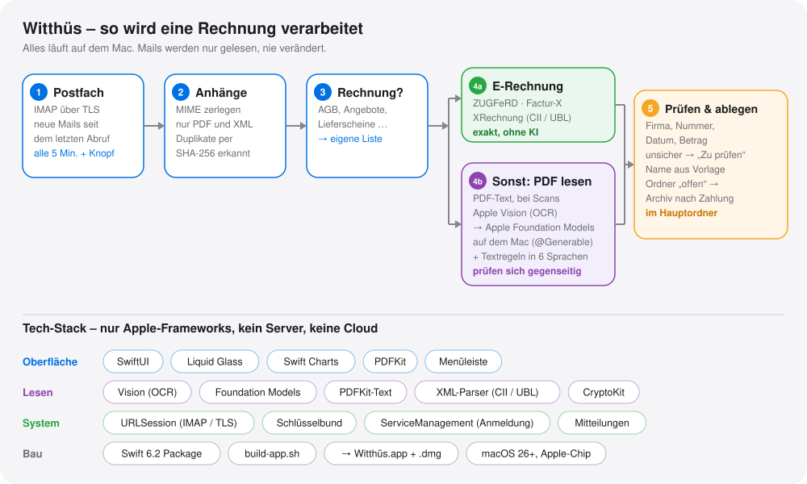

# Witthüs

Eine Mac-App, die Rechnungen aus dem Postfach holt, umbenennt und in einen Ordner ablegt, zum Beispiel einen Ordner, der mit OneDrive synchronisiert wird. Unbezahlte Rechnungen liegen in einem Ordner für offene Rechnungen. Bezahlte wandern in einen Archivordner, zum Beispiel einen pro Monat. Wie die Ordner heißen, legt man in den Einstellungen fest.



Sie ist für ein MacBook Air M1 mit 8 GB gebaut und läuft komplett auf dem Mac: ohne Cloud-Dienst, Docker oder lokales Sprachmodell zum Selbstinstallieren.

- [Was die App macht](#was-die-app-macht)
- [Installieren auf einem anderen Mac (AirDrop)](#installieren-auf-einem-anderen-mac-airdrop)
- [Einrichten](#einrichten)
- [Automatisch oder per Knopf abrufen?](#automatisch-oder-per-knopf-abrufen)
- [Wie Rechnungen gelesen werden](#wie-rechnungen-gelesen-werden)
- [Entwickeln](#entwickeln)
- [Entscheidungen, offene Fragen und Ideen](#entscheidungen-offene-fragen-und-ideen)

## Was die App macht

1. **Mail abrufen:** Sie liest per IMAP das Postfach, standardmäßig Telekom (`secureimap.t-online.de:993`) mit der vollen Adresse und dem Homepage-Center-Passwort. Das Passwort liegt im macOS-Schlüsselbund. Mails werden nur gelesen: nie verschoben, gelöscht oder als gelesen markiert. Apple Mail kann also weiterlaufen wie bisher.
2. **Nur Rechnungen:** Sie nimmt nur PDF- und XML-Anhänge und ignoriert alle anderen Dateien. AGB, Angebote, Lieferscheine, Auftragsbestätigungen und Newsletter landen unter „Keine Rechnungen“ und können dort von Hand abgelegt werden.
3. **Umbenennen und ablegen:** `yy-mm-dd Firma Rechnungsnummer.pdf`, zum Beispiel `26-03-07 Telekom Deutschland 19 5683 1701 2621.pdf`, im Ordner für offene Rechnungen. Vorhandene Ordner werden wiederverwendet, fehlende angelegt. Nichts wird überschrieben: Gibt es den Namen schon, hängt die App „ (2)“ an. Doppelte Rechnungen erkennt sie am Dateiinhalt.
4. **Bezahlt:** „Als bezahlt markieren“ mit Zahlungsdatum verschiebt die Datei (und eine XML daneben) in den Archivordner.

### Oberfläche

- **Übersicht (Dashboard):** Zeitraum aus dem Menü („Dieser Monat“, „Letzter Monat“, „Dieses/Letztes Quartal“, „Dieses/Letztes Jahr“, „Letzte 12 Monate“, „Gesamt“) oder „Eigener Zeitraum“ mit Von/Bis-Datum. Mit „Anpassen“ lassen sich Widgets hinzufügen, entfernen, per Ziehen umsortieren und auf halbe oder volle Breite stellen; die Anordnung bleibt gespeichert. Widgets: Kennzahlen (Klick öffnet die Liste), Betrag im Zeitverlauf, Anzahl Rechnungen, Zahlungen nach Zahlungsdatum, Größte Lieferanten (Kreisdiagramm mit Anteilen), Wie Rechnungen gelesen wurden, Zahlungsdauer, Warten auf Zahlung und Zu prüfen.
- **Rechnungen:** Offen, Bezahlt, Zu prüfen, Alle. Links das PDF, rechts die Felder zum Korrigieren. Darunter der Dateiname zum Ändern; die „Vorlage“ darunter zeigt den Namen nach dem Namensformat aus den Einstellungen und setzt ihn mit „Übernehmen“ ein. Ein eigener Name bleibt auch beim Bezahlen erhalten; der Ordner kommt immer aus den Einstellungen. Dann „Speichern & umbenennen“ und „Als bezahlt markieren“.
- **Archiv:** „Alle Dateien“ und der Hauptordner. Der Hauptordner öffnet sich wie im Finder: oben der Pfad und die Unterordner als Kacheln (Klick öffnet, Stern legt den Ordner mit Ordnersymbol und Ordnernamen in die Seitenleiste unter „Archiv“), darunter die Dateien. Eine Tabelle wie im Finder oder in Excel: Spalten ein- und ausblenden (Dateiname, Ordner, Rechnungsdatum, Status, Bezahlt am, Rechnungsnummer, Firma, Empfänger, Betrag, Währung, Gelesen aus, Prüfung, Mail-Betreff, Importiert) und sortieren. Unten stehen Anzahl und Summe.
- **Suchen und Filtern:** Das Suchfeld durchsucht alles. Der Knopf „Filter“ fügt Regeln hinzu, etwa „Firma enthält Telekom“, „Betrag größer als 100“, „Rechnungsdatum liegt in 2026-03“, „Status ist Bezahlt“ oder „Zu prüfen“. Jede Regel steht als Abzeichen neben dem Suchfeld: Klick bearbeitet, ✕ entfernt, Rechtsklick → „Ausschließen“ blendet Treffer aus (rot). Das kleine „und“ zwischen den Abzeichen schaltet per Klick auf „oder“ um. Rechtsklick öffnet die Datei, zeigt sie im Finder oder markiert sie als bezahlt oder offen.
- **Ansichten:** Suche und Filterregeln lassen sich mit Namen und Symbol speichern (Lesezeichen-Menü in der Symbolleiste). Mit Stern erscheint die Ansicht in der Seitenleiste unter „Ansichten“. Rechtsklick dort zum Bearbeiten (Name und Symbol), Stern entfernen oder Löschen.
- **Menüleiste:** Status, „Jetzt abrufen“, die fünf neuesten Rechnungen, Einstellungen, Beenden. Neue Rechnungen melden sich mit einer Mitteilung.
- **Bezahlte Rechnung hinzufügen** (Symbolleiste, ⇧⌘N): für Belege, die nicht per Mail kommen. Zahlungsdatum wählen, dann **Aus Fotos**, **Scannen** (öffnet die Kamera des iPhones über die Continuity-Kamera; iPhone mit derselben Apple-ID in der Nähe) oder **Datei oder Ordner** (PDF, XML, Bilder; bei Ordnern auch alle Unterordner). Fotos werden als einseitiges PDF gespeichert und von der Texterkennung gelesen. Die Rechnung landet direkt im Archivordner. Findet die App kein Rechnungsdatum, nimmt sie das Zahlungsdatum und legt die Rechnung unter „Zu prüfen“.
- **Ziehen und Ablegen:** PDFs oder XML-Rechnungen aus dem Finder ins Fenster ziehen.
- **Ältere Mails lesen** (Seitenleiste unter „Mail“ oder ⇧⌘R): Zeitraum (Von/Bis) und beliebige Mailordner wählen, etwa ein Archivordner aus Apple Mail. Die App durchsucht diese Mails noch einmal nach Rechnungen. Schon abgelegte erkennt sie am Dateiinhalt und legt sie nicht doppelt ab. Der normale Abruf läuft danach unverändert weiter.
- **In Mail öffnen:** Unter „Aus Mail“ neben jeder Rechnung öffnet ein Knopf die ursprüngliche Mail in Apple Mail, um die Quelle zu prüfen. Das klappt, solange die Mail in Apple Mail vorhanden ist.
- Glas-Look (Liquid Glass von macOS 26), Symbol aus dem „W“ des Witthüs-Logos, alles auf Deutsch.

## Installieren auf einem anderen Mac (AirDrop)

Die installierbare Datei ist **`Witthüs.dmg`**. Der Ziel-Mac braucht **macOS 26 oder neuer** und einen **Apple-Chip** (M1 oder neuer).

### 1. Die Datei bauen (auf einem Mac mit Xcode)

Einmalig Xcode 26 oder neuer aus dem App Store installieren und einmal öffnen, damit es die Lizenz bestätigt. Dann im Terminal:

```sh
git clone https://github.com/jan-kuwert/witthues-management.git
cd witthues-management/Witthues
./build-app.sh
```

Danach liegen in `Witthues/dist/`:

- `Witthüs.app`: die App selbst
- `Witthüs.dmg`: die App plus eine Verknüpfung zu „Programme“. Diese Datei verschickt man.

### 2. Übertragen

`Witthüs.dmg` im Finder rechts anklicken → **Teilen → AirDrop** → den anderen Mac wählen. Ein USB-Stick, OneDrive oder eine Mail gehen genauso.

### 3. Auf dem anderen Mac installieren

1. `Witthüs.dmg` aus „Downloads“ doppelklicken.
2. Im Fenster **Witthüs** auf den Ordner **Programme** ziehen. Dann das Fenster schließen und die DMG im Finder auswerfen.
3. **Erster Start:** Die App ist nicht mit einem bezahlten Apple-Entwicklerkonto signiert. macOS meldet deshalb beim ersten Öffnen, dass die App nicht geprüft werden kann.
   - Auf **Fertig** klicken (nicht „In den Papierkorb legen“).
   - **Systemeinstellungen → Datenschutz & Sicherheit** öffnen, ganz nach unten scrollen, bei „Witthüs wurde blockiert“ auf **Dennoch öffnen** klicken und mit dem Mac-Passwort bestätigen.
   - Das ist nur einmal nötig. Danach startet die App normal.

   Alternative im Terminal: `xattr -dr com.apple.quarantine /Applications/Witthüs.app`
4. Mitteilungen erlauben, wenn macOS fragt. In den Einstellungen der App unter „Abruf“ „Witthüs beim Anmelden starten“ einschalten, damit sie nach jedem Neustart läuft.

### Update (alle Daten bleiben erhalten)

Einstellungen, Passwort, Ansichten, Dashboard-Anordnung und die Liste der Rechnungen liegen **nicht in der App**, sondern in `~/Library/Application Support/Witthues/`, im Schlüsselbund und in den App-Einstellungen von macOS. Die Rechnungen selbst liegen im Hauptordner (OneDrive). Ein Update tauscht nur die App aus:

```sh
cd witthues-management
git pull
cd Witthues && ./build-app.sh
```

Dann auf dem Ziel-Mac Witthüs beenden (Menüleiste → Beenden), die neue `Witthüs.dmg` öffnen und die App nach „Programme“ ziehen → **Ersetzen**. Beim nächsten Start ist alles wie vorher. Wird auf demselben Mac gebaut, reicht `cp -R "dist/Witthüs.app" /Applications/` nach dem Beenden. Nach dem Ersetzen kann macOS einmal wieder „Dennoch öffnen“ verlangen.

**Ohne Warnung beim ersten Start** geht es nur mit einem Apple-Developer-Konto (99 €/Jahr): dann mit einer „Developer ID“ signieren und von Apple notarisieren lassen. Für einen Mac im Büro lohnt sich das nicht.

## Einrichten

Einstellungen öffnen (⌘,).

**Ordner**

- **Hauptordner** wählen, zum Beispiel einen Ordner, der mit OneDrive synchronisiert wird. Alle anderen Ordner liegen darunter.
- Ordner und Dateiname sind Vorlagen mit Variablen. „Ordner wählen …“ kann auch neue Ordner anlegen. Eine Vorschau zeigt, wo eine neue Rechnung landet und wohin sie nach dem Bezahlen wandert.
- Es gibt drei Vorlagen: den Ordner für offene Rechnungen, den Archivordner für bezahlte Rechnungen und den Dateinamen. `/` in einer Vorlage erzeugt Unterordner, zum Beispiel `{yyyy}/{mm}` für einen Ordner pro Jahr mit Monatsordnern darin.

Der Dateiname ist standardmäßig `{yy}-{mm}-{dd} {company} {invoice}`, also etwa `26-03-07 Telekom Deutschland 19 5683 1701 2621.pdf`.

| Variable | Bedeutung |
|---|---|
| `{yyyy}` `{yy}` `{mm}` `{dd}` | Rechnungsdatum (2026, 26, 03, 07) |
| `{paid_yyyy}` `{paid_mm}` `{paid_dd}` | Zahlungsdatum |
| `{company}` | Firma, die die Rechnung geschickt hat, ohne „GmbH“ usw. (früher `{customer}`, das weiterhin funktioniert) |
| `{buyer}` | Empfänger der Rechnung |
| `{invoice}` | Rechnungsnummer |
| `{total}` `{currency}` | Bruttobetrag, Währung |

Zeichen, die macOS oder OneDrive nicht erlauben, werden ersetzt. Unbekannte Variablen werden in den Einstellungen markiert.

**Mail:** E-Mail-Adresse, Passwort, Server, Port und TLS. Dazu der Ordner, der gelesen wird (Standard INBOX), und ab welchem Datum beim ersten Abruf gelesen wird (Standard: die letzten 30 Tage). „Speichern & Verbindung testen“ meldet sich an und listet die Ordner auf. Mit „Ordner ab diesem Datum neu lesen“ lässt sich später nachholen. Bereits abgelegte Rechnungen werden dabei erkannt und nicht doppelt abgelegt.

**Abruf:** Beim Start abrufen, Intervall (2, 5, 15, 30, 60 Minuten oder „Nie (nur „Jetzt abrufen“)“), Beim Anmelden starten, Apple Intelligence an oder aus.

## Automatisch oder per Knopf abrufen?

Empfehlung: **automatisch**, und zwar so, wie es eingebaut ist:

- Beim Start ruft die App neue Mails ab, danach alle 5 Minuten, solange sie läuft. „Jetzt abrufen“ (⌘R) geht jederzeit.
- Das Fenster darf geschlossen werden: Die App bleibt in der Menüleiste und prüft weiter. Erst „Beenden“ stoppt sie.
- Mit „Witthüs beim Anmelden starten“ läuft sie nach jedem Neustart von selbst.

Das kostet fast nichts, auch auf 8 GB. Bei jedem Abruf fragt die App den Server nur nach Mails, die neuer sind als die zuletzt gesehene. Meist ist das eine kurze Anfrage ohne Ergebnis. Das Sprachmodell läuft nur, wenn wirklich eine neue Rechnung ohne eingebettete XML da ist.

Bewusst nicht gebaut:

- **Ein unsichtbarer Hintergrunddienst ohne App:** Er wäre schwerer zu verstehen und zu reparieren und brächte hier nichts. Die Menüleisten-App ist genauso „im Hintergrund“.
- **Push vom Server (IMAP IDLE):** Rechnungen kämen damit sekundenschnell. Telekom trennt solche Dauerverbindungen aber gern. Alle 5 Minuten reicht für Rechnungen.

## Wie Rechnungen gelesen werden

Der Reihe nach, das Erste, was klappt, gewinnt:

1. **E-Rechnung (exakt, ohne KI):** In PDFs eingebettetes ZUGFeRD/Factur-X und XRechnung/Peppol als XML (CII oder UBL). Kommt eine XRechnung neben einem PDF, wird die XML gelesen und neben dem PDF abgelegt.
2. **Text aus dem PDF:** Bei Scans mit kaum Text, oder wenn der eingebettete Text unlesbar ist, liest Apples Texterkennung (Vision OCR) die Seite.
3. **Apples Sprachmodell auf dem Mac** (Foundation Models, typisierte `@Generable`-Ausgabe) holt Firma, Rechnungsnummer, Datum, Betrag und Währung aus dem Text. Dafür muss Apple Intelligence eingeschaltet sein.
4. **Textregeln** in Deutsch, Englisch, Französisch, Spanisch, Italienisch und Niederländisch prüfen das Ergebnis. Eine Rechnungsnummer, die so nicht im Text steht, gilt als erfunden, und die Regel gewinnt. Ohne Apple Intelligence arbeiten die Regeln allein.
5. **Firma:** aus dem Briefkopf (eine Zeile mit GmbH, AG, SARL, Ltd …), sonst aus dem Absender der Mail. Beides wird zur Prüfung markiert.

Alles, was unsicher ist, landet unter **„Zu prüfen“**. Dort die Felder korrigieren und „Speichern & umbenennen“.

Es kommen Rechnungen aus Deutschland und aus dem Ausland, viele ohne eingebettete XML. Deshalb ist Schritt 3 der Normalfall und Schritt 1 der Glücksfall.

**Stand mit den fünf Beispielrechnungen** (getestet ohne KI und ohne Texterkennung, weil der Cloud-Mac beides nicht kann):

- Telekom: alle Felder richtig.
- Herder: Firma, Datum und Betrag richtig. Rechnungsnummer fehlt → „Zu prüfen“.
- Hassler: Datum und Betrag richtig. Firma fehlt → „Zu prüfen“.
- Villringer, Maison & Objet (Fotos von Belegen): unter „Keine Rechnungen“. Für Fotos wurde absichtlich nichts Eigenes gebaut. Die allgemeine Texterkennung sollte sie auf dem echten Mac lesen, das ist noch ungetestet.

## Entwickeln

Swift-Paket in `Witthues/`:

| Ziel | Inhalt |
|---|---|
| `WitthuesCore` | IMAP-Client, MIME, E-Rechnung (CII/UBL), Textregeln, Extraktion (Vision + Foundation Models), Vorlagen, Ablage, Bibliothek, Einstellungen/Schlüsselbund |
| `Witthues` | Die SwiftUI-App (Übersicht, Rechnungen, Archiv, Ansichten, Einstellungen, Menüleiste) |
| `witthues-cli` | Kommandozeile zum Testen der Extraktion |
| `WitthuesCoreTests` | Tests |

```sh
cd Witthues
swift test                                      # Tests
swift run witthues-cli extract rechnung.pdf      # zeigt, was gelesen wird und den Dateinamen
./build-app.sh                                  # dist/Witthüs.app und dist/Witthüs.dmg
```

- Daten (Rechnungsliste, Ansichten, Abrufstand) liegen als JSON in `~/Library/Application Support/`. Mit `WITTHUES_HOME=/pfad` lässt sich ein anderer Ordner nutzen, etwa für Demodaten: `open --env WITTHUES_HOME=$HOME/WitthuesDemo dist/Witthüs.app`.
- Das App-Symbol wird mit `Resources/make_icon.py` aus dem Logo erzeugt.
- Echte Rechnungen nie ins Repository legen.

## Entscheidungen, offene Fragen und Ideen

Entschieden:

- **Archivmonat:** Bezahlte Rechnungen kommen in den Ordner für den Monat der Rechnung (`{yyyy}`, `{mm}`), nicht den Monat der Zahlung. Wer es anders will, nimmt `{paid_yyyy}` und `{paid_mm}`.
- **`{company}`:** die Firma, die die Rechnung schickt.

Offene Frage:

- **Datum im Dateinamen:** Es wird das Rechnungsdatum verwendet. Einige der Beispieldateien waren anders benannt.

Noch auf dem echten M1 zu testen: Telekom-Anmeldung, Apple Intelligence, Texterkennung bei Scans und Fotos.

Ideen für später:

- Push vom Mailserver (IMAP IDLE) statt Abruf alle paar Minuten
- Mit Developer ID signieren und notarisieren (keine Warnung beim ersten Start)
- Export nach Excel/CSV (vorerst nicht nötig)
- Eigene Behandlung für Fotos von Belegen (vorerst zu speziell)
